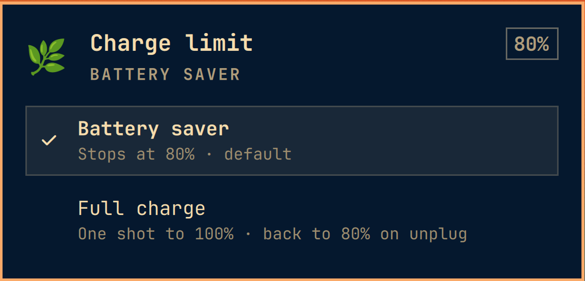
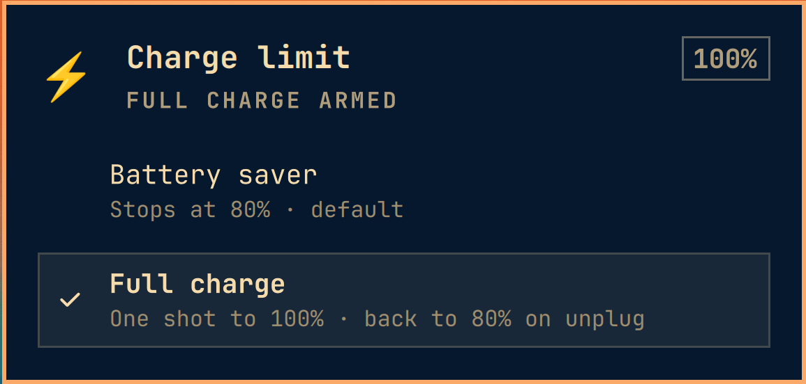

# Omacharge Limit

Battery charge limit switch for the Omarchy bar. Two modes:

- **🌿 Battery saver** — stops charging at 80% (default, battery-friendly)
- **⚡ Full charge** — charges to 100%, reverts to 80% on unplug

## Screenshots

| Saver (default) | Full charge (one-shot) |
|---|---|
|  |  |

## Install

```bash
omarchy plugin add https://github.com/rubar/omacharge-limit.git --enable
```

Then run the one-time helper setup (needs sudo):

```bash
~/.config/omarchy/plugins/rubar.charge-limit/tools/install-helper.sh
```

This installs `/usr/local/bin/charge-limit-apply` (root-owned) and a strict passwordless sudo rule scoped to that binary.

## Usage

- **Left-click** the bar pill → open panel with mode selection
- **Right-click** the bar pill → instant toggle
- **Unplug charger** → auto-reverts to 80%

## How it works

Reads/writes `/sys/class/power_supply/BAT0/charge_control_{start,end}_threshold`. Writes go through a root-owned helper (`charge-limit-apply`) with a scoped sudoers rule — no password prompt, no shell injection.

The widget polls sysfs every 15s (3s while panel is open) and watches `UPower.onBattery` for the auto-revert.

## Requirements

- Omarchy Linux (Hyprland + Quickshell shell)
- A battery with `charge_control_end_threshold` support (most modern laptops)

## License

MIT
